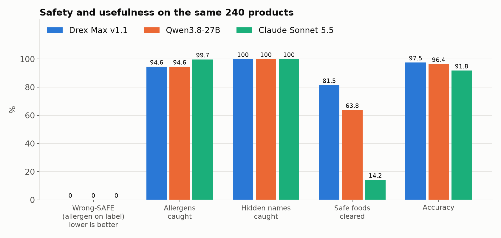

# SafeBite: Snap the label. Know if it's safe.

**Drexathon 2026 · Track 1 (Apex Predator) + NDI bonus**

SafeBite reads the ingredient label on a food packet and tells a person with allergies whether it is safe:
✅ **SAFE**, ⚠️ **CHECK CAREFULLY**, ⛔ **NOT SAFE**, or 📷 **RETAKE PHOTO**. Risky ingredients are boxed in red on the photo.

For Track 1 we handed a frontier-LLM task (per-allergen safety decisions) to **Drex**, then measured it head to head
against **Claude Sonnet 5.5** and **Qwen 3.8 27B** (DeepInfra) on the same 240 real products.

## Results (240 Open Food Facts products × 9 allergens = 2,160 decisions per model)

| | **Drex Max v1.1** | Claude Sonnet 5.5 | Qwen 3.8 27B |
|---|---|---|---|
| Median latency | **357 ms** | 2,103 ms | 16,865 ms |
| Cost per 1,000 scans | **$0.036** | $6.60 | $3.30 |
| Wrong-SAFE on allergens named on the label | **0 / 352** | 0 / 352 | 0 / 352 |
| Safe foods correctly cleared | **81.5%** | 14.2% | 63.8% |
| 4-way accuracy | **97.5%** | 91.8% | 96.4% |
| Hidden-name recall (whey, semolina, …) | **100%** | 100% | 100% |
| Calibration error (ECE, lower is better) | **0.011** | 0.104 | 0.049 |

**Drex is 6× faster and 181× cheaper than Claude Sonnet 5.5, equally safe, and clears 5.7× more safe foods.**
Full table: [bench/results.md](bench/results.md). Charts: [charts/](charts/).



### Honest notes
- **Raw wrong-SAFE rate:** Drex 21, Qwen 21, Claude 1 (of 390 allergen-present pairs). We inspected every case.
  Each is an allergen that Open Food Facts tags but that appears **nowhere in the product's ingredient text**
  (for example a "may contain" warning printed elsewhere on the pack), so no model could see it. Claude avoids
  them by almost never saying SAFE, which is also why it clears only 14% of safe foods.
- **Bug caught in a live test:** "PRODUCED ON EQUIPMENT THAT ALSO PROCESSES PEANUTS…" was missed by our
  statement parser, so neither model saw it. Fixed in `safebite/label_text.py` with tests in
  `tests/test_label_text.py`, and scans now also pass the full label text. The benchmark dataset was unaffected
  (0 statements changed).
- **Dataset:** 361 products were dropped because their allergen tags contradicted their own ingredient text.
  Sesame, fish and crustaceans have few US products, so their numbers are less reliable.
- The Drex price uses $0.03 per 1M input tokens (spec). LLM costs use DeepInfra and Anthropic list prices.

## How it works

```
photo -> NDI parse (text + paragraph locations)
      -> Drex readability gate on the ingredient area (P(readable) >= 0.85, else RETAKE)
      -> hidden-name dictionary + contains / may-contain statements -> shared state
      -> Drex: one request, one choice question per allergen -> probabilities
      -> (comparison) LLM: same state, JSON answer + confidence
      -> safety rules (identical for every model) -> verdict + red/yellow boxes
      -> Intern "Detective" explains unclear results on demand
```

**Safety rules** (`safebite/decide.py`): error or timeout → CHECK (never SAFE); P(contains) ≥ 0.30 → NOT SAFE;
P(may contain) ≥ 0.30 → NOT SAFE if severe, CHECK if mild; P(not found) ≥ 0.95 → SAFE; otherwise CHECK.

## Nace tools used
| Tool | Where |
|---|---|
| **NDI** | `safebite/ndi_client.py`: upload, parse, and paragraph polygons used for the boxes |
| **Drex Max v1.1** | `safebite/drex_client.py`: every allergen decision plus the photo readability gate |
| **Intern** | `safebite/intern_client.py`: the in-app Detective (`intern -p --json`, System 1 = Drex, System 2 = Qwen on DeepInfra). Intern was also used as a coding agent for `synonyms.py` and the first `fetch_off.py`. |
| **DeepInfra** (partner) | Qwen 3.8 27B baseline and Intern's System 2 |

## Run it

```bash
python3.12 -m venv .venv && .venv/bin/pip install -r requirements.txt
cp .env.example .env        # add NACE_API_KEY, DEEPINFRA_API_KEY, ANTHROPIC_API_KEY
.venv/bin/streamlit run app.py
```

Reproduce the benchmark:
```bash
.venv/bin/python bench/fetch_off.py          # 240 products from the Open Food Facts dump on Hugging Face
.venv/bin/python bench/run_bench.py --llm-model Qwen/Qwen3.8-27B --llm-model claude-sonnet-5-5
.venv/bin/python bench/charts.py
.venv/bin/python -m pytest tests             # 16 tests: safety rules + warning parsing
```

Optional Intern Detective: `uv tool install --python 3.12 "intern-agent @ git+https://github.com/nace-ai/intern"`.

## Layout
```
app.py                  Streamlit app: Scan | Benchmark
safebite/               clients (NDI, Drex, LLM, Intern), rules, pipeline, drawing
bench/                  dataset builder, benchmark runner, charts, results
data/                   benchmark products, demo photos
tests/                  safety rules + label parsing
```

---
*SafeBite is an assistant, not a guarantee. Always double-check the label and follow your doctor's advice.*
